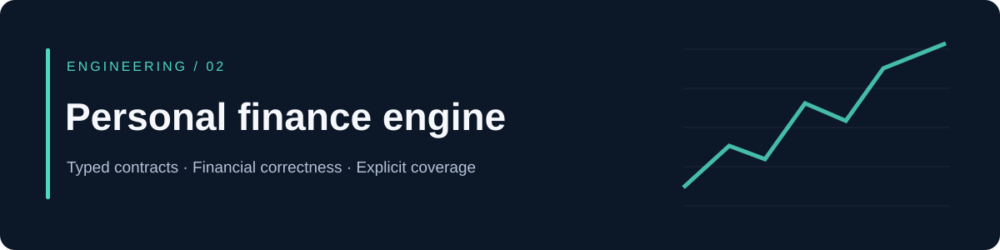
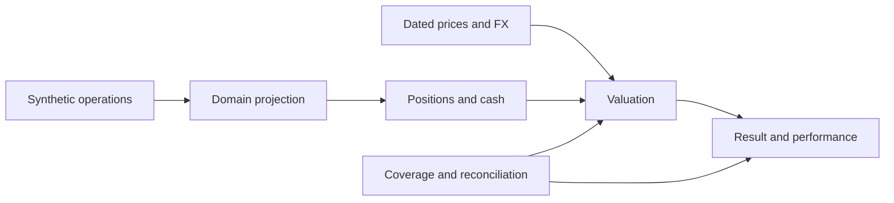

# Personal finance engine

**A tested financial domain extracted from a private personal finance application.**

[](https://github.com/AlbertoDc99/personal-finance-engine/actions/workflows/tests.yml)


How do you value an investment when prices are missing, currencies differ, and deposits must not appear as investment returns?

This repository exposes the calculation layer of a larger application I am building. It focuses on explicit financial semantics, typed contracts and reproducible synthetic examples. The domain implementation and its existing tests were extracted from the private project; the public demo and documentation were added for this portfolio edition. Existing domain names and comments remain in Spanish.

## Run it in a minute

Python 3.11 or later. The demo has **no third-party runtime dependencies**, credentials or network calls.

```bash
git clone https://github.com/AlbertoDc99/personal-finance-engine.git
cd personal-finance-engine
python demo.py
python -m pip install --upgrade pip setuptools
python -m pip install -r requirements-dev.txt
python -m pytest -q
```

| Synthetic scenario | Expected behavior |
|---|---|
| 10 units × USD 50 × 0.92 EUR/USD | EUR 460.00, with price and FX provenance |
| Next-day valuation with the previous price | `carried_forward`, original price date retained |
| No applicable price | `null`, never an invented zero |
| Start 1,000; end 1,300; deposit 200 | Period result 100, not 300 |

## What the code demonstrates

- **Data contracts:** immutable value objects and entities, decimal arithmetic, explicit currencies and operation states.
- **Projection and reconciliation:** operation histories become positions; discrepancies remain visible.
- **Valuation:** historical prices and FX retain effective dates; incomplete coverage is represented explicitly.
- **Performance:** contributions, investment result, time-weighted return and XIRR have distinct meanings and coverage checks.
- **Testing:** synthetic fixtures cover domain invariants and boundary cases. A purity test keeps infrastructure outside the domain.



## Connection to the full application

The private project includes a Streamlit web interface, a FastAPI read API, an Android client, bank ingestion and scheduled processing. The shared domain keeps financial calculations outside those interfaces.

**This public repository contains the domain only.** It does not include the application UI, authentication, bank connectors, cloud configuration, persistence or personal financial records. Its tests establish behavior of this extraction, not the security or deployment state of the full system.

Read the [engineering case study](docs/engineering.md) for design choices, boundaries and interview discussion points.

## Explore

| Start here | What to inspect |
|---|---|
| [demo.py](demo.py) | Four small, reproducible scenarios |
| [Domain](src/investments/domain/) | Value objects, projection, valuation and performance |
| [Tests](tests/investments/domain/) | Financial edge cases with synthetic evidence |
| [Security scope](SECURITY.md) | What was deliberately excluded |

Part of [Alberto Dueñas's data and finance portfolio](https://github.com/AlbertoDc99).
